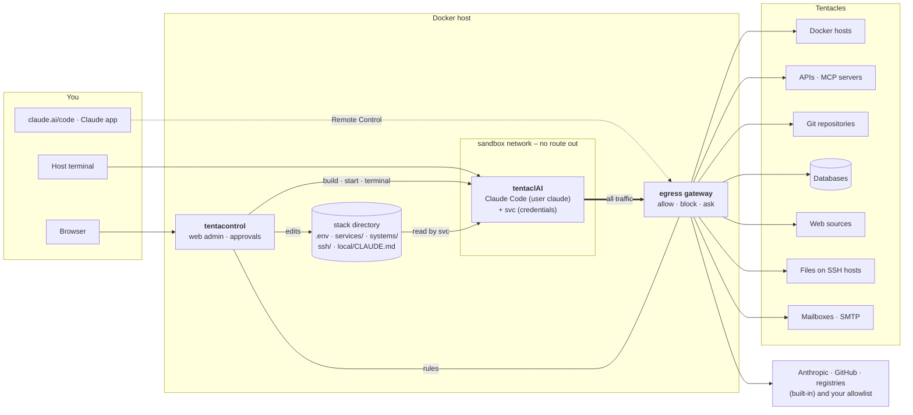

<p align="center">
  <picture>
    <source media="(prefers-color-scheme: dark)" srcset="docs/brand/wordmark-on-dark.png">
    
  </picture>
</p>

<p align="center"><strong>Long arms, one brain – safely caged.</strong><br>
Sandbox + service gateway for Claude Code.</p>

<p align="center">▶ <a href="https://www.bitbunker.at/tentaclai/"><strong>Watch the intro video</strong></a></p>

<p align="center">
  
  
  
  
</p>

tentaclAI runs [Claude Code](https://claude.com/claude-code) in its own container and gives it **controlled access to
your infrastructure** – Docker hosts, APIs, MCP servers, git repositories, databases, websites, mailboxes and files on other machines.
Every connection is a **service** you add on purpose, with its own access mode: read-only (`read`), read-write (`write`) or
every write waits for your approval (`confirm`). A web admin, **tentacontrol**, sets it all up, and you talk to Claude
from the browser, from your phone or from the terminal.

**More than a sandbox:**

- **Network isolation** – the sandbox has no route out. All traffic, DNS included, goes through an egress gateway
  that records every destination and, in `enforce` mode, asks you before Claude reaches anything new.
- **Credentials stay out of reach** – Claude runs unprivileged and never sees a token, password or SSH key. `svc` injects
  them at call time, and Claude can't change its own access rights.
- **Approvals and audit** – writes to `confirm` services wait in tentacontrol (or show up as a notification on your
  phone) and every write is logged.
- **Prompt-injection safeguards** – mail and web pages reach Claude marked as untrusted and without hidden text;
  content that tries to instruct Claude is flagged to Claude and to you.
- **Site knowledge** – a guided inventory and per-service onboarding record what your systems are for and which rules
  apply. Claude reads this at the start of every session.

**Beyond the sandbox:**

- **Scheduled jobs** – Claude tasks run on a schedule, e.g. a patch report, certificate expiry, disk space, backups or
  container health. They're read-only by default, give a traffic-light result and only notify you when something is
  wrong. A job can also suggest fixes that you approve with one click.
- **Notifications** – ntfy, webhook, e-mail or any Apprise URL, with quiet hours.
- **Always reachable** – a permanent Remote Control session (QR code in tentacontrol), web terminals that survive
  closing the tab, and two-factor sign-in.
- **Topology & inventory** – a live graph of everything Claude can reach, down to stacks and containers.
- **Claude settings in one place** – edit its instructions, memory, models, skills and settings.json, and see your plan usage.

<p align="center">
  
</p>

**Contents:** [Why](#why) · [How it works](#how-it-works) · [Getting started](#getting-started) ·
[Connecting a service](#connecting-a-service) · [Working with Claude](#working-with-claude) · [tentacontrol](#tentacontrol) ·
[Service reference](#service-reference) · [Configuration](#configuration) · [Security](#security) · [Roadmap](#roadmap)

---

## Why

Claude Code is great at operating systems – reading logs, fixing a compose file, querying an API, writing an automation.
Pointed at real infrastructure – servers, a homelab, company or cloud services – two questions come up immediately: *what may it touch?* and *how does it know
my setup?* tentaclAI answers both: Claude sees nothing by default and reaches only the services you connect, each with
an access mode the `svc` tool in the container enforces – and a guided inventory plus per-service onboarding write down
what your systems are for and which rules apply.

## How it works



**Tentacles** are everything Claude can reach: services (APIs, MCP servers, Docker hosts, databases, web sources,
files, git repos, mail), SSH hosts and the systems that group them. You set them up in tentacontrol → *Tentacles*; each one
has its own access mode, and `svc` is the only way to use them. Everything else on the network is the job of the
egress gateway (tentacontrol → *Network*).

**Two layers of control.** `svc` decides *what* happens with a tentacle (it holds the credentials and enforces
`read`/`write`/`confirm`); the egress gateway decides *where* the sandbox may connect at all (built-in list, tentacles, your
allow/block lists – and in `enforce` mode it asks you about everything else).

The stack consists of **three containers** and one **stack directory**:

| Part | What it is |
|---|---|
| **tentaclAI** (container `tentaclai`) | The sandbox: Claude Code, `svc`, git, gh, database clients, tmux (docker runs on the hosts over SSH). Runs the permanent Remote Control session and holds your workspace (`/workspace`). Has **no** Docker socket, no host access and no route to the outside of its own – services go through `svc`, all traffic through the egress gateway. |
| **egress gateway** (container `tentaclai-egress`) | The sandbox's only way out: a small forward proxy (CONNECT for any port, plain HTTP; TLS is not opened). Allows the built-in list and your tentacles, applies your allow/block lists, records every destination and – in `enforce` mode – holds unknown destinations until you approve them in Approvals. |
| **tentacontrol** (container `tentacontrol`) | The web admin: create and edit services, systems and SSH hosts, enter tokens, test connections, start onboarding, see the topology, open terminals into the sandbox, rebuild and update it. It uses the host's Docker socket only to run the tentaclAI container. |
| **`svc`** (inside tentaclAI) | The gateway Claude uses for every service: `svc <name> GET /path`, `svc docker`, `svc compose`, `svc db`, `svc web`, `svc files`, `svc mail`, `svc git`, `svc jobs`. It runs as root (via sudo), injects credentials from `.env` at call time and enforces `read`/`write`/`confirm`; Claude itself runs as user `claude` and can't read `.env` or the SSH key. |
| **Services** (`services/<name>.json`) | One file per thing Claude may reach. A service can combine parts: `api`, `mcp`, `git`, `docker`, `db`, `web`, `files`, `smtp`, `imap`. Secrets are `${VAR}` placeholders, the values live in `.env`. |
| **Systems** (`systems/<name>.json`) | Optional groups – e.g. *the NAS* = its SSH host + Docker + a database + an API – with a shared SSH host and rules that apply to every member. Services can also stand alone. |
| **SSH hosts** (`ssh/config.d/*.conf`) | Machines reachable with tentaclAI's own key, optionally with a sudo prefix for non-root users. Docker and file services use them. |
| **Site knowledge** | Claude's instructions are assembled on every start from generic rules, an optional host document, `local/CLAUDE.md` (your site rules) and generated tables of Docker and SSH hosts. A service catalog (`/workspace/SERVICES.md`) lists every service, system and rule. Claude keeps it up to date itself: what it learns while working, or what you tell it (also as the reason of a denial), it proposes as a note where it applies – service, system or site rules – always through an approval that shows the diff. |

**Generic by design.** Code, templates and examples are the same for every installation. Everything site-specific lives in
`.env`, `compose.override.yaml`, `local/CLAUDE.md`, `services/`, `systems/`, `ssh/` and `data/` – all git-ignored.

## Getting started

Requirements: a Linux host with Docker (compose plugin) and a claude.ai account (Remote Control needs a claude.ai login,
an API key is not enough). A tentaclAI installation runs Claude with **one person's** account – yours; in a team, each
person runs their own installation with their own account.

```bash
git clone https://github.com/mwaldegg/tentaclai.git /srv/stacks/tentaclai
cd /srv/stacks/tentaclai
./tentaclai.sh init        # one question – how to reach tentacontrol (LAN port / localhost / nginx-proxy / Traefik) –
                           # then builds and starts everything and prints the one-time setup link
```

Everything else gets a default you can change later under **Settings** (host name, domain, git identity, remote
control, resources); `./tentaclai.sh init --advanced` asks it all, `--defaults` asks nothing. Then, in tentacontrol:

1. **Setup link** – set your username and password.
2. **Overview → Sign in now** – `claude auth login` in a web terminal; sign in with your claude.ai account.
3. **Tentacles → SSH hosts → Add host** – *This host* fills in the machine tentaclAI runs on (`host.docker.internal`);
   with *Docker host* ticked, the dialog checks the host key, puts tentaclAI's key on the host (one-time password, or a
   line to paste), tests the login, checks Docker, finds the stacks directory and adds the Docker service – access
   *confirm*: Claude reads freely, every change waits for your approval. Ask Claude `svc docker <host> ps`.
4. **Overview → Remote Control** – scan the QR code or open the link; the session shows up in claude.ai/code and the app.
5. **Tentacles → Services** – connect more services ([next section](#connecting-a-service)).
6. **Overview → System inventory** – Claude scans everything read-only, interviews you and writes `local/CLAUDE.md`.

By default tentacontrol listens on port 8484 in the LAN (`CONTROL_BIND`, `CONTROL_PORT`) – keep it off the internet:
it holds the host's Docker socket.

**Updating:** `./tentaclai.sh update` – goes to the latest release: shows what's new and the upgrade steps, rebuilds and
asks before recreating the containers (`--check` only shows, `--main` takes the newest unreleased state of `main`).
tentacontrol also shows “Update available” in the sidebar.

## Connecting a service

<p align="center">
  
</p>

1. **Create from a template.** Tentacles → Services → *Add service* → search the template list (48 templates: Docker hosts, Home Assistant, Proxmox,
   Grafana, n8n, GitHub, PostgreSQL, wikis with login, folders on a NAS, …) → name → *Create service*.
2. **Fill in the details.** Adjust URL/host/path in the JSON editor; enter tokens under *Tokens & variables*. Tokens are
   write-only: they go into `.env` and are never shown again.
3. **Place it.** Put it into a system with the ⋯ menu (*Move to …*) or leave it standalone.
4. **Test connection.** `svc test` checks every part – HTTP status of the API, MCP endpoint, git remote, Docker version,
   database login, web login, folder on the SSH host, SMTP/IMAP login – and tells you exactly what is missing.
5. **Onboard with Claude.** Opens a terminal with `/onboard <service>`: Claude tests the service, explores it **read-only**
   (API resources, tables, stacks, page structure …), summarizes what it found and asks you what the service is for, what it
   may do on its own, what only after asking and what never. It writes the answers – purpose, rules, examples – into the
   service file, so every later session knows them.

The service catalog for Claude and its instructions are regenerated on every change; new tokens work immediately.

**System inventory** (`/inventory`) is the counterpart for the whole site: `tc-scan` collects hosts, stacks, containers,
networks, services and SSH hosts read-only (never env files or secrets), Claude asks about purpose, criticality, backups,
taboos and conventions, and – after your approval – writes the result into `local/CLAUDE.md`. Run it again whenever the
setup changes; existing knowledge is kept.

## Working with Claude

| Where | How |
|---|---|
| **Phone / any browser** | Remote Control session (`claude-rc`), always running: claude.ai/code or the Claude app. |
| **tentacontrol → Terminal** | Web terminal into the sandbox: Claude in `/workspace`, the Remote Control session, a shell, onboarding/inventory sessions. Sessions run in tmux and survive closing the tab. |
| **Host terminal** | `./tentaclai.sh` (Claude), `./tentaclai.sh rc`, `./tentaclai.sh shell` (as user claude; `rootshell` as root), `./tentaclai.sh status`, `./tentaclai.sh update`. |

Inside the sandbox, Claude (and you) use:

```bash
svc list | info <name> | test <name>        # services, details, connection test
svc systems [name]                          # systems with SSH host, members and rules
svc <name> GET /path [curl args]            # API call, auth injected – tokens never in argv; HTTP 4xx/5xx exits non-zero
svc docker <host> ps                        # docker CLI on a docker host (over SSH, sudo-aware)
svc compose <host> <stack> logs --tail 50   # compose in <stacks_dir>/<stack> of that host
svc db <name> "SELECT …" | tables           # databases (read = read-only session)
svc web <name> /wiki/page | --links         # web pages as readable text (untrusted, hidden elements left out), login handled by svc
svc files <name> ls|cat|grep|pull|diff|push # folders on SSH hosts; edit in /workspace/files/<name>
svc mail <name|address> send|list|read|flag|move    # mail: send (smtp), read a mailbox (imap) – mail text is untrusted
svc git | git sync [name]                   # repos in /workspace/repos (no credentials inside)
svc git push|pull|fetch <repo> [branch]     # through svc's mirror – access mode and approval apply
svc ssh <host> [command]                    # command or shell on an SSH host (status commands free, others need approval)
svc config put service|system|local|skill|job …   # Claude proposes a service or system file, the site rules, a site skill or a job – always needs approval
svc jobs [name|--group G] [--steps]         # scheduled jobs (one group), a definition with its recent runs (and Claude's steps)
svc pending | audit [n]                     # approvals waiting in tentacontrol (also in Claude's status line) / last writes
# tab completion for all of these in the sandbox shells
tc-scan                                     # read-only inventory of all docker hosts, services, SSH hosts
```

Claude commands: **`/onboard <service>`** and **`/inventory`** (see above).

## tentacontrol

| Page | Purpose |
|---|---|
| **Overview** | Status of the sandbox (resources, Claude version, login, plan usage as bars), Remote Control with QR code and on/off switch, Docker and SSH hosts with live status, system inventory. |
| **Terminal** | xterm.js terminals into the sandbox (Claude, Remote Control, shell, login). Reconnects automatically. |
| **Tentacles** | Everything Claude can reach, in four tabs: **Services** (grouped by system, live status dot per service; templates (incl. own ones: download a service as a template, import one), JSON editor, write-only tokens, connection test and test path, onboarding, enable/disable, rename, move between systems; shows which services share a token variable) · **SSH hosts** (live status; add with host key check and one-time password key deployment, edit incl. jump host, sudo and rename, remove with key revocation) · **Systems** (groups with SSH host and rules) · **Topology** (live graph incl. optional stacks/containers, search, saved layout, PNG export). |
| **Network** | Every destination the sandbox connected to (rule, last connection, filters), your allowlist and blocklist with one-click Allow/Block, the tentacles and the built-in list, and the switches *Mode* (permissive / enforce) and *IP targets* (ask / block) – see [Network control](#network-control). |
| **Approvals** | Pending approvals – writes of `confirm` services (Approve / Approve + 15 min / Deny with an optional reason) and unknown network destinations (Allow 10 min / 1 h / Always / Deny / Block), badge in the sidebar and in Claude's status line, a banner on every page, the count in the tab title and on the favicon, optional desktop notifications from the browser (also while tentacontrol is a background tab), and where each request came from (session, terminal, job). A configuration change (`svc config put`) shows its diff, with a ⚠ when the added text reads like an instruction to an AI. The reason of a denial reaches Claude, which proposes a lasting rule as a note. A Claude session that waits longer than `APPROVAL_HANDOFF` seconds (default 30) posts the link to the request in the chat and then waits again for the same request – useful with Remote Control in the browser, where a running command shows nothing. *Recent requests* lists the latest decisions (from the audit log, *Logs → Audit*). |
| **Jobs** | Claude tasks on a schedule – presets, cron or *manual*, profile *read-only* (default, enforced by Claude Code and `svc`) or *standard*, a traffic-light answer (ok / warn / alert) and notifications only on findings; history per job, run now, pause, stop, clone; optional groups by topic, shown as tabs (job counts and a warn/alert badge per tab, move a job from the list), with an order (arrows on the cards) and *Run the group in order* – each job starts when the one before has finished, a failed or stopped run ends it; `@name` mentions of tentacles (completed in the editor, checked on save) and the option to limit a job to them (`svc` refuses everything else); *Propose actions*: a read-only run suggests `svc` commands, you pick which ones run (exactly as written, through `svc`, for 24 h); live state while a run is going; templates for patch report, certificates, disk space, backups, container health. The sidebar badge counts findings you haven't looked at. From a terminal: `svc jobs [name] [--steps]` shows jobs and their recent runs, `svc config put job <name> <file>` proposes one (approval in Approvals, new jobs start paused).; each run may propose what it learned (notes for a service, a system or the site rules – you pick, they are applied with a backup) and a better version of its own task (a minimal change, shown as a diff with the word count before → after); templates *Learning review* (weekly, from the audit log) and *Knowledge cleanup* (monthly, keeps notes and site rules within a budget) |
| **Claude** | Everything that steers Claude, in six tabs: **Instructions** (a diagram of what Claude reads every session and what it looks up when needed, an editor for your site rules `local/CLAUDE.md`, the generated `CLAUDE.md` to view), **Memory** (what Claude noted for itself – view, delete entries), **Models** (model and effort for all sessions, subagents and `/inventory`·`/onboard`; subagents and the set-up commands start on Sonnet), **Skills** (per skill of Claude Code and the account *On* / */command only* / *Off* – each listed skill costs context in every request; sandbox-useless ones start off; *site skills* – procedures of this installation Claude proposed with `svc config put skill`, kept in `local/skills/` – with their steps and *Remove*), **Usage** (plan limits and what contributes to them, tokens per day, sessions and models – from Claude Code's `/usage` and the local session files, no model call), **settings.json** (Claude Code's own settings, without the parts the other tabs manage; checked before saving, last 5 versions kept). |
| **Settings** | All `.env` settings with descriptions; secrets are write-only. Shows *Apply now* when the sandbox must be recreated. Group *Jobs*: text helpers for read-only jobs. Group *Prompt injection*: the safeguards on/off. Tab **Notifications**: channels (ntfy, webhook, e-mail or any Apprise URL), which event goes where, quiet hours. Tab **Account**: your account (username, email, name, password), two-factor sign-in (authenticator app, recovery codes, trusted browsers). Tab **Export / Import**: the configuration as one JSON file without secrets (services, systems, SSH hosts, jobs, network rules, notifications, site rules, site skills, settings); import with a preview, per-entry choice and `.bak` copies, then fill in the missing variables. |
| **Updates** | Installed tentaclAI version, new releases with their upgrade steps (checked every 6 h, also shown in the sidebar; `UPDATE_CHECK=false` turns it off), Claude Code and image updates. |
| **Logs / Help** | Container log; full documentation of every feature. |

One admin account – username, email and optional name, chosen at the first setup; sign-in with username + password
(bcrypt). The username names you in the audit log and on approvals; change it, the email and the password under
Settings → Account. Optional **two-factor sign-in** (TOTP from an authenticator app, 10 one-time recovery
codes, “trust this browser” for 30 days – revocable), signed session cookie (12 h, SameSite=Strict), login throttling.
Reset: `./tentaclai.sh passwd` (shows the username, also revokes trusted browsers; `--username <name>` renames),
`./tentaclai.sh reset-2fa`. tentacontrol itself is updated on the host: `docker compose up -d --build control`.

## Service reference

A service file can combine any of these parts:

```jsonc
{
  "name": "paperless",
  "description": "Paperless-ngx – documents",
  "system": "homeserver",                       // optional
  "api":    { "base_url": "https://paperless.home.lan/api",
              "auth": { "type": "header", "header": "Authorization", "value": "Token ${PAPERLESS_TOKEN}" } },
  "mcp":    { "type": "http", "url": "https://paperless.home.lan/mcp", "headers": { "Authorization": "Token ${PAPERLESS_TOKEN}" } },
  "notes":  ["Never delete documents."],
  "examples": ["svc paperless GET /documents/?page_size=5"]
}
```

| Part | Fields | Access control |
|---|---|---|
| `api` | `base_url`, `auth.type`: `none` · `bearer` · `header` · `basic` · `query` · `oauth2_client_credentials`; `insecure_tls`; `access` (default `write`) | writes = everything but GET/HEAD/OPTIONS |
| `mcp` | like Claude's `.mcp.json`: `http` (`url`, `headers`) or `stdio` (`command`, `args`, `env`); `access` (default `read`), `read_tools` / `write_tools` | tools the server marks read-only run freely; every other tool call is a write |
| `git` | `url`, `access`, `auth` (token via credential helper) | `read`: push blocked (pushurl + pre-push hook) |
| `docker` | `mode` `ssh` (the only one): `ssh_host`, `stacks_dir`; `access` | `read`: only read-only docker/compose commands |
| `db` | `engine` `postgres`/`mysql`, `host`, `port`, `database`, `user`, `password`, `ssl`; `access` | `read`: read-only session, no shell |
| `web` | `base_url`, `auth.type`: `none` · `basic` · `bearer` · `header` · `form` (`login_url`, `fields`, `csrf_field`); `paths` | GET only, same host |
| `files` | `ssh_host` (or the system's), `path`, `sudo`; `access` | `read`: no push; paths stay inside `path` |
| `smtp` | `host`, `port`, `security` (`starttls` · `ssl` · `none`), `user`, `password`, `from`, `recipients` (addresses or `@domain`); `access` (default `confirm`) | `confirm`: every mail waits for approval; `write` only with a `recipients` list |
| `imap` | `host`, `port`, `security` (`ssl` · `starttls` · `none`), `user`, `password`, `folders`; `access` (default `read`) | `read`: list and read (never marks as seen); `write`/`confirm`: mark and move, never delete |

**TLS:** internal services with your own CA → set `CA_CERT` (trusted by curl, git, python and node). For devices with self-signed
certificates, `"insecure_tls": true` in `api`, `web`, `git`, `db`, `smtp` or `imap` (or the switch on the service page) skips certificate
verification for that part only – the connection stays encrypted (also for `mcp`: svc's proxy makes the connection).

**Access modes** (`access` in `api`, `mcp`, `docker`, `git`, `db`, `files`, `smtp`, `imap`): `read` refuses writes, `write` allows them, `confirm` makes
every write wait for your approval in tentacontrol → **Approvals** (denied or no answer within 10 minutes = not executed).
The names before v0.16, `ro` and `rw`, still work as `read` and `write`; tentacontrol rewrites them on start (with a
backup) and only writes the new ones. An unknown value counts as `read`.
**MCP tool calls** go through the same gate: every MCP server is registered in Claude as `svc mcp-proxy <name>` (http
bridged with the tokens added, stdio as a child process run by `tcrun`), which sees each tool call. Tools the server marks
read-only (`readOnlyHint`) run freely and are logged as reads; every other tool is a write – `read` hides and blocks it,
`write` logs it, `confirm` asks first; a tool marked `destructiveHint` is a risky write (asked on its own, even during a
grant). Correct the server's marks with `"read_tools"` / `"write_tools"` (names or `fnmatch` patterns) in the `mcp`
part; the service page lists the tools with their kind as last seen. In a read-only job only the reading tools are offered.
Everything lands in the **audit log** (tentacontrol → Logs → Audit, or `svc audit` in the sandbox): Claude's tool calls,
every `svc` command (reads and writes, approvals, blocked attempts), network connections, jobs, your changes and
sign-ins in tentacontrol – with a search line (`actor:claude outcome:denied docker`), filters with counts per field,
a histogram over time, details per entry and CSV / JSON-lines export; secrets are never logged. Every entry carries a
correlation id (`cid`): all entries of one `svc` call (its *started* entry, the result, the approval card) share one,
and so do all entries of one request in tentacontrol – `cid:<id>` finds them. Pending approvals and grants survive a
restart of tentacontrol (`data/control/approvals.json`); a waiting `svc` call keeps waiting through it.

A part stays inactive while one of its `${VAR}`s is empty; `"enabled": false` parks the whole service.

**Rule of thumb:** a *service* is only needed for credentials or write access – public, read-only sources (docs, registries, public repos) just need an entry in tentacontrol → Network. One *service* = one way in with one set of credentials (an API and its MCP server may share a file);
one *system* = one machine or appliance that groups several services.
Systems: `systems/<name>.json` with `description`, `ssh_host`, `notes` (rules for every member) – see `systems/_example.json`.
SSH hosts: tentacontrol → Tentacles → SSH hosts, or `./ssh-host.sh list|add|sudo|hostkey|remove|test` (same logic, e.g.
`./ssh-host.sh add nas admin@nas.lan --jump gate --sudo`); jump hosts via `ProxyJump`; the sudo prefix is stored as
`# tentaclai: sudo=sudo -n` in the host block and needs passwordless sudo, ideally limited to what Claude needs.

## Configuration

| Variable (`.env`) | Meaning |
|---|---|
| `TC_DIR` | absolute host path of this stack (mounted under the same path) |
| `TZ` | time zone of the containers (default `UTC`) – job schedules use it |
| `COMPOSE_FILE` | `compose.yaml:compose.override.yaml` |
| `DOCKER_SOCKET` | Docker socket of this host – for tentacontrol only |
| `HOST_DOCS` | optional Markdown file about the host – Claude's instructions point to it, Claude reads it before working on the host |
| `CA_CERT` | optional own root CA (PEM), trusted by curl, git, python and node in the sandbox |
| `TC_HOSTNAME`, `TC_DOMAIN` | name of this host for Claude; domain for the suggested tentacontrol address (templates use `example.com`) |
| `CONTROL_URL`, `CONTROL_BIND`, `CONTROL_PORT` | where tentacontrol is reachable |
| `CLAUDE_CPUS`, `CLAUDE_MEMORY`, `CLAUDE_CODE_VERSION` | sandbox resources, pinned Claude Code version |
| `GIT_USER_NAME`, `GIT_USER_EMAIL` | default git identity of Claude's commits – a git service can set its own (`"author": {"name", "email"}` in its `git` part) |
| `GH_TOKEN` | example token variable for the GitHub templates (`${GH_TOKEN}`) – no longer handed to `gh` in the sandbox |
| `RC_ENABLED`, `RC_NAME`, `RC_WORKDIR`, `RC_EXTRA_ARGS`, `RC_RESTART_DELAY` | Remote Control – re-read on every restart of the session |
| `JOB_READONLY_HELPERS` | text tools a read-only job may chain with `svc` (empty = the defaults: echo, head, tail, grep, jq, sort, uniq, wc, cut, tr, date, sleep) – shells, interpreters, awk/sed/find/xargs, network and write tools are refused |
| `EGRESS_MODE`, `EGRESS_LEARN_MINUTES`, `EGRESS_DIRECT_IP` | egress gateway: `learn` (in `.env.example`, length `EGRESS_LEARN_MINUTES`, 60), `permissive` (default when unset) or `enforce`; bare IP targets in enforce mode `block` (default) or `ask` – see [Network control](#network-control) |
| `INJECTION_GUARD` | prompt-injection safeguards (default on): untrusted markers and hidden-text cleaning for mail/web, scanning in `svc` and the `tc-guard` hook – `false` turns them off, see [Security](#security) |
| `CLAUDE_TELEMETRY` | `true` allows Claude Code's telemetry, error reports and `/bug` (default: off) |
| `UPDATE_CHECK`, `UPDATE_REPO` | release check every 6 h (`false` = no requests), repository to check (default `mwaldegg/tentaclai`) |
| `NOTIFY_URL_<ID>` | URL of a notification channel (written by Settings → Notifications) |
| `LOG_FORMAT`, `LOG_LEVEL` | tentacontrol's container log: `text` (default) or `json` (one object per line with `ts`, `level`, `logger`, `msg`, `request_id` – for a log shipper); `info` (default), `debug`, `warning`, `error`. Each web request gets an id (the proxy's `X-Request-ID`, or a new one), sent back as `X-Request-ID` and stored as `cid` in its audit entries |
| everything else | service credentials, referenced as `${VAR}` |

<details>
<summary>Repository layout</summary>

```
tentaclai/
├── compose.yaml               services claude (tentaclai), egress (tentaclai-egress), control (tentacontrol)
├── compose.override.*.yaml    site additions: reverse proxy, labels (example + your own)
├── .env.example               settings template (your .env: mode 600, git-ignored)
├── tentaclai.sh               host helper: init, Claude/RC/shell, status, inventory, passwd, setup-url
├── ssh-host.sh                SSH hosts on the command line (wraps tentacontrol-ssh – same logic as the UI)
├── lib/tclib.py               shared logic of both images: .env, ${VAR}, services, systems, SSH hosts
├── build/                     tentaclai image
│   ├── svc                    service gateway CLI
│   ├── tc-scan                read-only inventory
│   ├── claude-instructions    assembles Claude's CLAUDE.md (base rules + host docs + site rules + host tables)
│   ├── CLAUDE.base.md         generic rules for Claude
│   ├── commands/              /inventory, /onboard
│   └── entrypoint.sh, start.sh, rc-loop, cc
├── control/                   tentacontrol (FastAPI, HTMX, xterm.js, cytoscape.js – vendored, no CDN at runtime)
│   └── app/                   main.py (app, middleware, background loops), routes/ (one router per area), web.py
├── egress/gw.py               egress gateway (forward proxy, rules from tentacontrol)
├── services/                  your services (git-ignored) + _template.json + _templates/ (48 templates)
├── systems/                   your systems (git-ignored) + _example.json
├── ssh/                       /root/.ssh of the sandbox (root only – used by svc): config, config.d/, keys/ (git-ignored)
├── local/                     CLAUDE.md with your site rules (template: CLAUDE.example.md)
├── data/                      git-ignored: claude/ (Claude's home: login, settings, sessions), home/ (root's home: svc
│                              state, git mirrors), control/ (tentacontrol: password hash, rules, settings state, jobs
│                              and their runs)
├── scripts/                   test-quick.sh, test-sandbox.sh, release.sh, check-site-data.sh, brand/screenshots
├── tests/                     pytest suite of scripts/test-quick.sh
├── workspace/                 /workspace: projects, repos/, files/, SERVICES.md
└── docs/                      screenshots, brand images
```
</details>

## Network control

All traffic of the sandbox leaves through the egress gateway; tentacontrol → **Network** shows and controls it.

**Mode** – how the gateway treats a destination that no rule covers:

| Mode | Unknown destination |
|---|---|
| `learn` (new installations) | `permissive` for `EGRESS_LEARN_MINUTES` (60) from the sandbox's first connection, then `enforce` – the destinations seen meanwhile without a rule are offered on the Network page (*Allow all*, or one by one) |
| `permissive` (default when `EGRESS_MODE` is not set) | allowed and recorded |
| `enforce` | held for up to 60 s while you decide in **Approvals** (*Allow 10 min*, *Allow 1 h*, *Always*, *Deny*, *Block*); refused if nobody answers. The card names the process in the sandbox that opened the connection and the Claude session or job it belongs to (looked up while the connection is held – a hint, like every origin), and how many connections wait for the same decision; the audit entry keeps both and when it was first requested. *Recent requests* notes *Always* and *Block* under *Decided by* |

**IP targets** – connections to a bare IP address instead of a name (`curl https://93.184.215.14`). Normal programs
almost always use names, so in `enforce` mode such a connection without a rule is blocked (`block`, default) or asked
about like any other unknown destination (`ask`). `EGRESS_DIRECT_IP` in `.env`.

**Rules**, checked in this order:

1. **Built-in** – Anthropic (Claude Code, login, remote control), GitHub, PyPI, npm. Always allowed, can't be blocked.
2. **Blocklist** – always refused, even for tentacles.
3. **Allowlist** – entries you added (Network tab, *Allow* on a destination, or *Always* in Approvals).
4. **Tentacles** – hosts of your active services and SSH hosts, derived live (nothing to maintain).
5. **Temporary approvals** – *Allow 10 min* / *Allow 1 h*.

Entries: `host`, `*.domain` (subdomains only), an IP address or range (`10.0.0.0/8`), each optionally with `:port`.
The gateway resolves names itself and checks IP rules against the resolved address, so a blocked range can't be reached
through an allowed name. *Seen* lists every destination with its rule and last result (filters, **Clear**).

Claude Code's telemetry, error reports and `/bug` are off by default (`CLAUDE_TELEMETRY=true` turns them on).

## Modules

tentacontrol can be extended with **modules** – Python packages that bring pages, sidebar entries, tabs, background
tasks, notification events and parts of Export / Import (tentacontrol → Modules):

- **Built-in** modules ship with tentaclAI and are off until enabled:
  - **Service-Health** – runs `svc test` for every service on a schedule (default every 5 minutes), shows the state,
    a 24-hour bar and the availability over 24 hours and 7 days per service and system, and sends the notifications
    *Service down* / *Service up again* (after 2 failed checks in a row by default; Settings → Health).
- **Third-party** modules go into `local/extensions/<name>/` (a package with an `extension.json`) and are off until
  enabled – a module runs inside tentacontrol with all of its rights, so only enable code you trust. Their pages live
  below `/x/<name>/`; they can't replace tentacontrol's own.
- **Enterprise** modules are packages named in `TC_EXTENSIONS` (none by default) – always loaded, they may provide a
  license and unlock modules with it.
- **Install from file**: a module packaged as `.tcpkg.zip` is installed offline from the Modules page – checked first,
  packages signed by tentaclAI get Enterprise rights, unsigned ones are third-party modules; every file
  is checked again at each start ([docs/extensions.md → Packages](docs/extensions.md#packages)).

**Central management:** *Enterprise* in the sidebar connects an installation to a central server (tentaclAI Enterprise) as
an agent – it sends its status and audit log, and a signed profile from the server can set and lock parts of its
configuration (enforced / default items; credentials stay local). Users of the server can sign in through it (*Sign in
with …*, part *Sign-in*, needs `CONTROL_URL`); a profile can allow only that – emergency access for the local admin is
`./tentaclai.sh passwd [--open]` on the host (local sign-in for an hour). The agent connects to the server, never the
other way round. Protocol: [docs/central.md](docs/central.md).

Writing one: [docs/extensions.md](docs/extensions.md) (Extension API v1), example in
[examples/extensions/tcx_hello](examples/extensions/tcx_hello).

## Security

What tentaclAI does:

- Claude reaches only what you connect; `svc` enforces `read`/`write`/`confirm` per service (docker/compose sub-commands, read-only DB
  sessions, blocked git push, no file push, same-host web fetches) and logs every write in the audit log – **before**
  it runs: a write that can't be logged is not executed (the entry *started*, then its result; a *started* entry
  without a result means the call was interrupted).
- **Risky writes are marked:** Approvals flags actions like `docker run --privileged` or a mounted `/`, `compose down -v`,
  `rm -rf`, `DROP TABLE`, `DELETE` without `WHERE` or a force push in red and says what approving gives (Docker on a host =
  root there). *Approve + 15 min* never covers a risky write – it is asked for on its own.
- Credentials are injected at call time via environment or 0600 files on tmpfs – never in command lines, never shown in the UI.
- Claude's own permission prompts stay active in sessions; its rules tell it to ask before restarts, updates and deletions.
  Scheduled jobs run unattended: *read-only* jobs are locked down twice (Claude Code's tool rules and `svc`, which treats
  every tentacle as `read`), a job can be limited to the tentacles its task names, and a *standard* job works like a session
  without prompts – `confirm` tentacles still wait for your approval.
- **Mail is untrusted content:** `svc mail … read` frames a mail between markers Claude's rules say never to obey;
  sending is `confirm` by default and `write` only with a recipient list.
- **Prompt-injection safeguards** (`INJECTION_GUARD`, on by default): mail and web pages come between untrusted-content
  markers, without hidden text (zero-width/direction/Unicode tag characters, elements hidden by CSS or `hidden`).
  Everything `svc` reads – and, through a Claude Code `PostToolUse` hook in the root-owned managed settings, WebFetch,
  WebSearch, MCP tools and files Claude reads, PDFs by their text (`pdftotext`; images are skipped) – is checked for
  text that tries to instruct an AI. A finding gives Claude
  a warning next to the content, an entry *flagged* in Approvals and a notification – the same findings in the same
  content again in one session get a short reminder instead of the full warning. This is a heuristic: hidden
  injections lose their effect and obvious ones are noticed, a well-disguised one can get through. The hard limits stay
  `read`/`confirm`, no secrets in the sandbox, the egress gateway and mail recipient lists – keep writes of tentacles
  that read mail or the web on `confirm`.

- **Privilege separation** in the sandbox: Claude runs as the unprivileged user `claude`. `.env`, the SSH key, the service
  files, git credentials and the audit log belong to root; Claude reaches them only through `svc` (via sudo), which enforces
  the access modes. Client tools (curl, psql, mariadb, stdio MCP servers) run as a third user `tcrun` with only the secret
  they need. Every MCP server runs behind `svc mcp-proxy`, git pushes go through a root-owned mirror – Claude never sees a
  token or the private key, and can't change its own access modes (`svc config put` always needs your approval).
- **tentacontrol is out of Claude's reach:** from the sandbox only `svc`'s endpoints for approvals and job proposals answer
  (with its token; an unrecognised address from the sandbox network counts as the sandbox);
  the admin UI, the login and the gateway's endpoints refuse the sandbox, and only the gateway may use the latter.
- **Other services' secrets are blanked in read-only output:** `docker … inspect`, `compose … config` and
  `systemctl show|cat` – free reads that would print container environments, interpolated `.env` values or unit
  `Environment=` lines – run through `svc` with values of secret-looking names (password, token, key, secret, auth …)
  and passwords in URLs replaced by `[redacted by svc]`. Logs and anything you approve explicitly are not filtered.

What it does **not** (yet) do – keep it in mind:

- An `write` Docker host – or an SSH user with unrestricted sudo – is effectively **root on that machine**. The sandbox
  itself never gets a Docker socket: docker hosts, this one included, are reached over SSH only.
- `tcrun` holds one secret at a time while a client runs: a shell escape in the interactive SQL shell (`\!`, approved
  separately in `confirm` mode) gets that user, its database password and the web cookie jars – not `.env` or the SSH key.
- **Egress gateway:** the sandbox has no route to the outside; all traffic goes through `tentaclai-egress`. `permissive`
  allows and records everything; `enforce` allows only the built-in list, your tentacles and your allowlist and
  asks you about the rest; `learn` (new installations) starts permissive and switches to `enforce` after an hour. Allowed destinations are still ways out – what Claude may *do* there is up to `svc`.
- DNS: the sandbox resolves only the stack's own containers – names outside are looked up by the egress gateway, so
  DNS is no way out either.
- tentacontrol holds the host's Docker socket – protect it with a strong password and keep it off the internet.
- `data/claude` holds the Claude login, `data/home` svc's state and `ssh/keys` the private key – back them up and protect them.

## Roadmap

**Focus: the core.** Modules and the tentaclAI Enterprise integration stay as they are – they keep working and get
fixes, but no new features for now. Development concentrates on the sandbox, `svc`, the egress gateway, the audit
log and a faster first setup.

- **Short-lived SSH certificates:** instead of one permanent key authorized on every host, tentaclAI runs a small
  SSH CA and signs a certificate per call or session, valid for minutes and limited to the host and principal it
  needs; hosts trust the CA once (`TrustedUserCAKeys`), revoking means removing the CA, and every certificate is
  in the audit log.
- **AI Assist for jobs:** describe what a job should do and Claude drafts it in the editor – task, schedule,
  profile, the tentacles it names and when to warn – or improves an existing one; you check and save it.

## License

MIT – see [LICENSE](LICENSE). This is tentaclAI Community; tentaclAI Enterprise is a separate package with additional
modules (e.g. compliance reports, SIEM export) that hooks into tentacontrol – see tentacontrol → Modules. Contributions welcome, see [CONTRIBUTING.md](CONTRIBUTING.md) and the [Code of Conduct](CODE_OF_CONDUCT.md); security reports: [SECURITY.md](SECURITY.md).

## Notice

tentaclAI is an independent open-source project. It is not affiliated with, endorsed by or sponsored by Anthropic.
Claude and Claude Code are trademarks of Anthropic, PBC; they are used here only to describe what this project works with.
